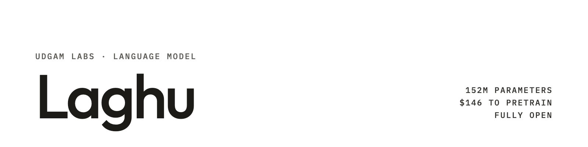
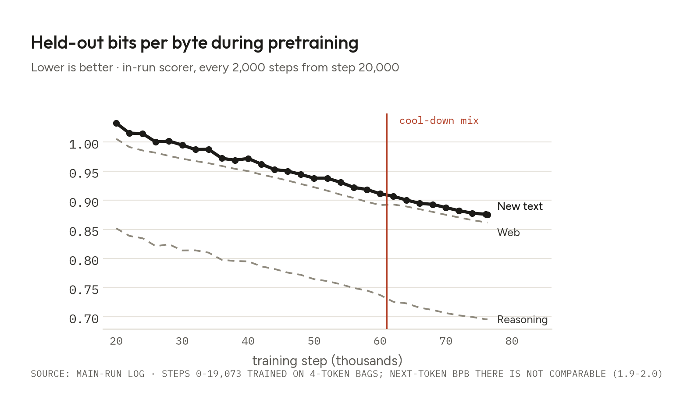
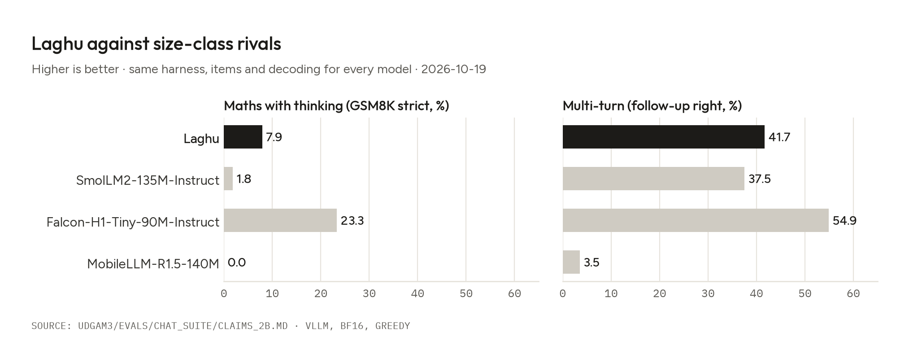

**UDGAM LABS** · Language model · 152M parameters, fully open

# Laghu

**Laghu is a 152M-parameter English chat model trained from scratch for $146 of pretraining compute** (8× A100 for
13.2 hours; about $194 for the whole project). It read about 71 billion training tokens, roughly 28 times fewer than
SmolLM2-135M, yet its base model predicts new text better than SmolLM2-135M and Falcon-H1-Tiny-90M-Base, and the chat
model is level with SmolLM2-135M-Instruct on chat quality and multi-turn conversation and ahead of it on maths. It has a
thinking on/off switch and a 16K-token context.

Laghu is a fully open research release: the weights, every checkpoint that survives, this code, the full recipe, the
data rebuild scripts, every evaluation output item by item, what failed, and what it cost.

*Laghu* (लघु) is Sanskrit for "small, light".

## In plain English

Laghu is a small AI model that chats in English, a very small cousin of the assistants you may know. It has 152 million
parameters (the numbers it learns during training); the recommended download is a single 163 MB file.

We made it in four steps:
1. **Gather text.** 52.6 billion tokens (pieces of words) from 14 openly licensed sources: educational web pages,
   maths, Wikipedia, permissive code and textbook-style text. We removed anything that overlapped the tests we report.
2. **Pretrain.** The model reads that text and learns to predict what comes next. This took 13.2 hours on 8 A100 GPUs
   and cost $146.
3. **Stretch to long inputs.** About 4 more hours on long books and papers, so it can use up to 16K tokens of input.
4. **Teach it to chat.** 41,467 example conversations (everyday questions, follow-ups, maths, writing, tools), shown
   twice.

What makes it unusual is not that it is the best small model (it is not; see below) but how little it took and how
much we show: every file, every checkpoint that survives, every test answer, what failed and what it cost. You can
check every number in this README against the files in this repository.



[Model card](https://huggingface.co/udgamlabs/Laghu) · [Try it](https://huggingface.co/spaces/udgamlabs/Laghu) · [Technical report](https://udgamlabs.com/research/laghu) · [udgamlabs.com](https://udgamlabs.com)

| | |
|---|---|
| Developer | Udgam Labs |
| Parameters | 151.8M (tied embeddings counted once) |
| Architecture | Gemma-4 text layout: 28 layers, width 640, 10 query / 2 key-value heads, 512-token sliding window with every 4th layer global |
| Tokenizer | our own, 32,768 tokens |
| Training | 40.0B token positions of pretraining at 2K (8× A100, 13.2 h), a 1B-token stretch at 32K, supervised fine-tuning on 41,467 conversations (2 passes) |
| Context | 16K tokens (recall fails beyond about 16K) |
| Licence | Apache-2.0 (weights and our code); `nanochat/` keeps its MIT notice, see [NOTICE](./NOTICE) |

## Get started

**Use the model.** The weights, GGUF and MLX files are on Hugging Face:
[Laghu](https://huggingface.co/udgamlabs/Laghu) (chat), [Laghu-Base](https://huggingface.co/udgamlabs/Laghu-Base),
[Laghu-Base-32K](https://huggingface.co/udgamlabs/Laghu-Base-32K),
[Laghu-Checkpoints](https://huggingface.co/udgamlabs/Laghu-Checkpoints),
[Laghu-GGUF](https://huggingface.co/udgamlabs/Laghu-GGUF), [Laghu-MLX](https://huggingface.co/udgamlabs/Laghu-MLX).
The model card has run commands for transformers, llama.cpp, Ollama and MLX.

**Reproduce it.** Every stage below ran from the files in this repository. Scripts are published exactly as they ran;
private Hugging Face repositories were renamed to `YOUR_HF_NAMESPACE/...` placeholders ([docs/NAME_MAP.md](./docs/NAME_MAP.md)),
and absolute paths became `$LAGHU_REPO` (the root of this repository).

| Stage | Entry point | What it needs | What it cost us |
|---|---|---|---|
| 1. Tokenizer | `udgam/tokenizer_train.py` (ready-made: `tokenizer/`) | CPU | — |
| 2. Pretraining data (14 public sources → 52.6B tokens, 13-gram decontaminated) | `udgam/build_mix.py --mix v3 --scale 5.0`; checks `udgam/test_mix.py`; pod script `udgam3/runs/data_v3/bootstrap_v3.sh` | 32 vCPU, ~400 GB disk, ~3.7 h | ≈ $5.8 (incl. one failed attempt) |
| 3. Pretraining (76,294 steps × 524,288 tokens) | `udgam3/runs/main/main.conf` (+ `shadeform/main_sf_a100.conf`), run by `ops/pod_train.sh` → `torchrun -m scripts.base_train` in `nanochat/` | 8× A100 80GB, 13.2 h | $146.26 |
| 4. 32K stretch data | `udgam2/ctx32k/build_long32k.py` (long documents), then `udgam3/runs/ctx32k/build_ctx32k_data.py` | CPU | $0 |
| 5. 32K stretch (1,900 steps at 32,768) | `udgam3/runs/ctx32k/colab_ctx32k_pipeline.sh` | 1× RTX PRO 6000 (96 GB), ~4 h | Colab units |
| 6. SFT data | `udgam3/sft/gen/` (generation, verification, screening), `udgam3/sft/render_v1.py` | DeepSeek API key (`DEEPSEEK_API_KEY`) | $9.49 |
| 7. SFT (2 passes) and the pick | `udgam3/sft/colab_sft_pipeline.sh` → `nanochat/scripts/udgam_sft.py`; pick rule `udgam3/sft/devpick/DEV_RULE.md` | 1× 96 GB GPU, < 1 h per run | Colab units, $0.07 judge |
| 8. RL (failed, not in the released model) | `udgam3/rl/` | 1× 96 GB GPU | Colab units |
| 9. Evaluation | base `udgam3/evals/phase0/`, chat `udgam3/evals/chat_suite/`, held-out bits per byte `udgam3/evals/own/`, chat-template matrix `udgam3/evals/template_matrix/` | 1× GPU (vLLM), DeepSeek API for the judge | $0.45 judge |

The exact settings of the main run (from `udgam3/runs/main/common.sh`): Muon optimiser; batch 524,288 tokens; 40 warm-up
steps; token bags (4 tokens per position) for the first 25% of steps; cool-down data from 80%; warm-down over the last
65% to 5% of the peak learning rate; weight EMA from 90% (β 0.998); bf16; seed 42.

## How it works

```
public datasets ──► udgam/build_mix.py ──► 52.6B-token pool ──► pretraining (2K) ──► Laghu-Base (step 76,294)
                                                                                         │
long documents ──► build_long32k.py ──► build_ctx32k_data.py ──► 32K stretch ──► Laghu-Base-32K (step 1,900)
                                                                                         │
prompts + DeepSeek-V4.1-Flash answers + verified data ──► render_v1.py ──► SFT, 2 passes ──► Laghu (chat)
```

| Folder | What is in it |
|---|---|
| `nanochat/` | the training code: our fork of karpathy/nanochat with the Gemma-4 layout, token bags, EMA, long-context evaluation, SFT and Hugging Face export |
| `udgam/` | tokenizer training and the pretraining-data builder (licence allow-list, filters, 13-gram decontamination, sharding) |
| `udgam2/` | the long-document pool builder shared with our earlier model Gargi |
| `udgam3/` | everything specific to Laghu (internal name Udgam-3): run configs, plans, checklists, SFT data generation, RL, evaluations and the pre-registration |
| `ops/` | scripts that ran on the training machines, and the training dashboard (a Cloudflare Worker) |
| `tokenizer/` | the tokenizer and chat template as used in training |
| `docs/` | name map, data licences and credits |

The pre-registration ([udgam3/PREREGISTRATION.md](./udgam3/PREREGISTRATION.md)) fixed the evaluation protocol, the rivals
and the release rule before the results were measured. Its amendment log records every change and whether it came
before or after the result it affects.

## Results

All numbers were measured by us with one harness for every model (vLLM, bf16, greedy, same items), on 2026-10-19.



**Chat model vs size-class rivals** (the three pre-registered categories):

| Category (metric) | Laghu | SmolLM2-135M-Instruct | Falcon-H1-Tiny-90M-Instruct | MobileLLM-R1.5-140M |
|---|---|---|---|---|
| Maths with thinking (GSM8K test, strict) | 7.9% | 1.8% | **23.3%** | 0.0% |
| Multi-turn (follow-up right, 144 items) | 41.7% | 37.5% | **54.9%** | 3.5% |
| Chat quality (Laghu's length-controlled win rate against the rival, 324 prompts, judge DeepSeek-V4.1-Flash) | — | 51.0% | 28.7% | 57.3% |

MobileLLM-R1.5-140M results are reported for noncommercial research under the FAIR Noncommercial Research License; we acknowledge Meta's materials.

Laghu is level with SmolLM2-135M-Instruct (pretrained on 2T tokens) on chat quality and multi-turn and ahead of it on
maths. Falcon-H1-Tiny-90M-Instruct, trained with about 12× our compute (800B tokens and a preference-tuning stage, from
TII's published description), is ahead in all three categories. Against our own 384M model Gargi, Laghu shows no
significant difference in chat quality (45.9% win rate, p = 0.06) or multi-turn (41.7% vs 49.3%, p = 0.12) at 40% of the
size. The categories, rivals and statistics were fixed in advance in the pre-registration.

**Base model** (lm-eval 0.4.13, zero-shot): 5-task commonsense average (ARC-Easy, ARC-Challenge, HellaSwag, PIQA,
WinoGrande) 49.9, 5th of the 19 models up to 200M we measured; SmolLM2-135M 51.8; Falcon-H1-Tiny-90M-Base 47.2.
On new text (Wikipedia pages created and arXiv abstracts submitted in September and October 2026), Laghu-Base scores
0.919 bits per byte (lower is better), ahead of SmolLM2-135M (0.941) and Falcon-H1-Tiny-90M-Base (0.979) and just behind
our 2.5× larger Gargi-Base (0.914); all three differences are significant in a paired bootstrap over the 1,695 documents.

**Long context:** a hidden 5-digit code is found 100 / 100 / 99 / 96% of the time at 4K / 8K / 12K / 16K tokens, and 0% at
24K and 32K.

Every table, with confidence intervals and the per-item outputs of every model, is in `udgam3/evals/` and the
technical report ([PDF in this repository](docs/REPORT.pdf), [web](https://udgamlabs.com/research/laghu)).

## Where it falls short

- **Maths:** 7.9% on GSM8K with thinking on; the arithmetic inside its thinking is often wrong.
- **Following instructions:** 26.1 on IFEval (prompt-level strict); Falcon-H1-Tiny-90M-Instruct scores 60.8.
- **Knowledge:** at 152M it knows little and states wrong facts confidently.
- **Loops:** 8.3% of greedy replies repeat until the length limit (12.0% with thinking on); the shipped sampling settings
  bring this to 1-2%.
- **Long context:** use up to 16K tokens; recall fails beyond that.
- **Thinking mode** helps maths a little but makes instruction following and multi-turn worse.
- **Missing checkpoints:** the pretraining checkpoints saved every 2,000 steps (steps 2,000-74,000) and some early 32K
  checkpoints were deleted by a storage clean-up on 2026-10-21, our mistake. Only the late states are published.
- **Reinforcement learning failed:** one RL attempt (GRPO with distillation from Gargi) did not improve maths and made
  loops worse, so the released model is the SFT model.

## Licence

Apache-2.0 for the weights and for Udgam Labs' code. Files that come from karpathy/nanochat keep their MIT licence; see
[NOTICE](./NOTICE). Training data stays under each source's own licence ([docs/DATA_LICENSES.md](./docs/DATA_LICENSES.md)).

---

**About Udgam Labs.** Udgam Labs is an independent AI research lab. We work from first principles: before we build, we understand why things work, whether we are training a model, fine-tuning one or applying AI to a new problem. Udgam (उद्गम) is Sanskrit for origin. [udgamlabs.com](https://udgamlabs.com)
